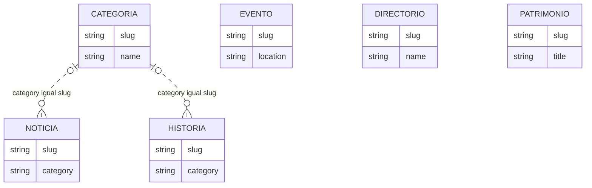

# Datos lógicos

Relaciones textuales, sin FK. Evento se asocia en la vista por coincidencia de location; no es relación formal.

Última revisión documental: 2026-09-16. Estado: reconstruido desde repositorio.
